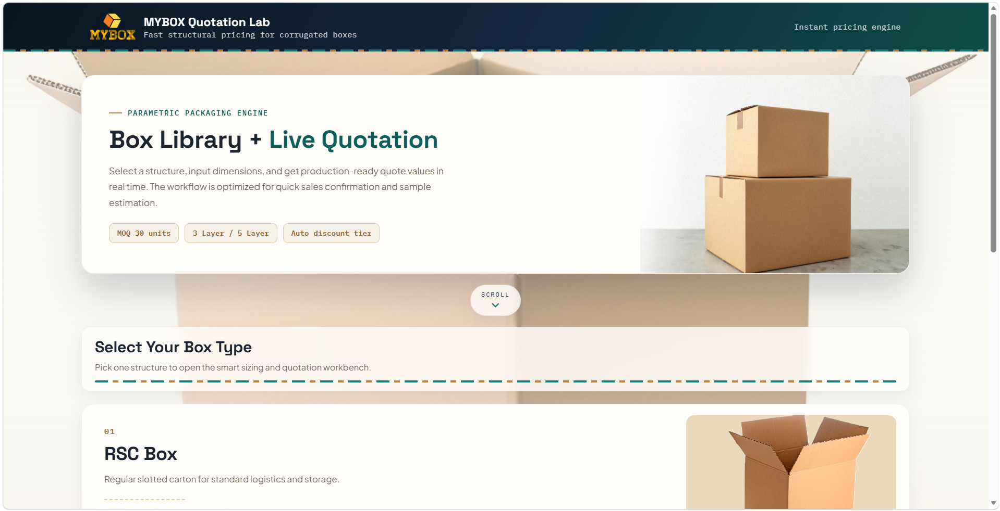
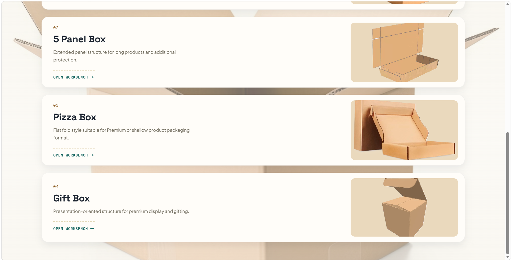
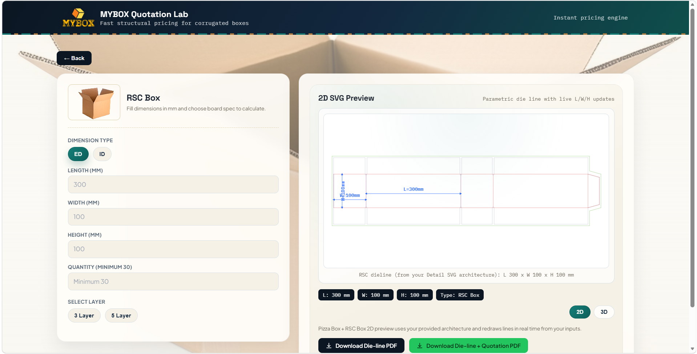
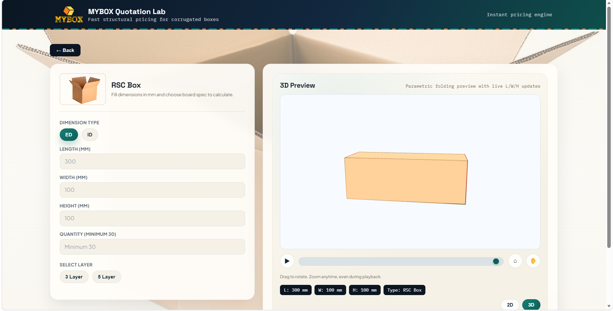
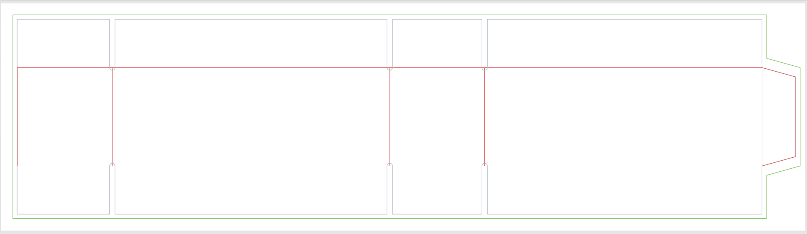

# MYBOX Quotation Lab

A corrugated-box quotation tool that turns a few dimensions into a **parametric 2D die line**, a **3D folding preview**, a **price estimate** and a **downloadable PDF drawing** — all in the browser, with no build step and no backend.

> Live demo: `https://ongwrk812-a11y.github.io/box-quotation/`

## Screenshots

**Home**




**2D die line**



**3D folding preview**



**Exported PDF drawing**



## Tech stack

| Area | Details |
| --- | --- |
| Language | Vanilla JavaScript (ES6), HTML, CSS — no framework, no bundler |
| 3D | [Three.js](https://threejs.org/) r128 + OrbitControls |
| PDF | [jsPDF](https://github.com/parallax/jsPDF) + [svg2pdf.js](https://github.com/yWorks/svg2pdf.js) (vector output) |
| Hosting | Static files — works on GitHub Pages |

Three.js, jsPDF and svg2pdf.js are loaded from a CDN, so an internet connection is needed.

## How it works

- **2D die lines** are generated as SVG. Each box type has a reference template; the template's key coordinates are remapped (piecewise-linear) to the target L/W/H so that fixed details such as tabs, slots and locks keep their real proportions.
- **3D models** are built from the same die-line geometry. The flat sheet is split into named panels, which are attached through a nested pivot hierarchy so that folding one panel carries along everything attached to it. A per-box player drives the fold sequence (5–8 phases per box).
- **Camera** uses spherical coordinates (distance, elevation, azimuth) around a per-box target, so each box type can have its own default view without affecting the others.
- **PDF export** regenerates the die line from the current inputs (rather than screenshotting the preview), strips the dimension overlay, inlines the computed styles, and converts the SVG to PDF. Template coordinates are in points, so the page size is the true physical size of the layout.

## Run locally

Clone or download the repository and open `index.html` in a browser.

If your browser blocks some features when opening the file directly, serve the folder with any static server, for example:

```bash
# Python 3
python -m http.server 5173
# then open http://127.0.0.1:5173
```

## Project structure

```
index.html                  # Home page + workbench page (layout and styles)
README.md
show_pic/                   # Screenshots used in this README
assets/
  images/                   # Box photos, logo, background images
scripts/
  app.js                    # State, input handling, pricing, 2D die-line generation
  pdf-export.js             # PDF drawing / quotation export
  models/                   # Die-line template data
    pizza-template-b-model.js
    gift-box-template.js
    five-panel-template.js
  3d/
    3d-scene.js             # Shared Three.js scene, camera and controls
    *-3d-model.js           # Per-box panel geometry and pivot hierarchy
    *-3d-player.js          # Per-box folding timeline
    *-3d-preview.js         # Per-box mounting and camera setup
                            # (one set each for rsc, five-panel, pizza, gift)
```

## Notes

- Prices shown may be outdated and are for reference only; they are not an official quotation.
- Die-line layouts are based on third-party reference templates and are used here for learning and demonstration purposes.

## About

Built as a solo project, originally for a packaging company's internal quoting workflow.
